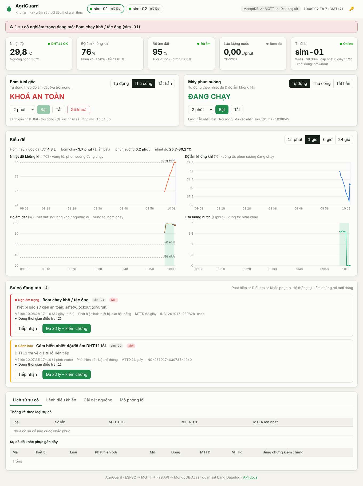

# AgriGuard – Giám sát tưới tiêu IoT thời gian thực (MongoDB + Datadog)

AgriGuard thu thập nhiệt độ, độ ẩm không khí, độ ẩm đất, trạng thái bơm và lưu lượng nước từ ESP32.
Hệ thống tự điều khiển **bơm tưới gốc** và **máy phun sương**, đồng thời phát hiện hỏng hóc như bơm chạy khô,
rò nước, cảm biến lỗi, mất kết nối hay thiết bị không phản hồi lệnh. Mỗi sự cố đi hết vòng
**Detect → Investigate → Resolve**. Khi người vận hành báo đã xử lý, hệ thống **tự kiểm chứng bằng dữ liệu thật**
rồi mới đóng sự cố.

```
ESP32 (DHT11, cảm biến đất, YF-S201, relay bơm, relay phun sương)      Simulator (dữ liệu GIẢ LẬP)
            │ MQTT: telemetry / status+LWT / ack / event                     │ cùng hợp đồng MQTT
            └────────────────────► Mosquitto ◄───────────────────────────────┘
                                      │  ▲ cmd
                                      ▼  │
                        FastAPI backend (ingest · luật phát hiện · điều khiển tự động · kiểm chứng)
                         │                    │ DogStatsD metrics + JSON logs + APM traces
                         ▼                    ▼
                   MongoDB Atlas         Datadog Agent ──► Datadog: dashboard · 14 monitors · 2 SLO
                   (time series)                              │ webhook khi monitor bắn/hồi phục
                         ▲                                    ▼
                    Web dashboard  ◄──────────────  /api/webhooks/datadog → incident trong MongoDB
```



Chi tiết kiến trúc, MongoDB data model, danh sách metrics Datadog và kịch bản D‑I‑R nằm trong
[docs/ARCHITECTURE.md](docs/ARCHITECTURE.md) và [docs/DIR_SCENARIOS.md](docs/DIR_SCENARIOS.md).
Phần cứng xem [firmware/WIRING.md](firmware/WIRING.md).

## Cấu trúc repo

| Thư mục | Nội dung |
|---|---|
| `firmware/` | Firmware ESP32 (Arduino) + sơ đồ đấu dây |
| `backend/` | FastAPI: ingest MQTT, MongoDB, luật phát hiện, điều khiển, incident, Datadog metrics |
| `web/` | Dashboard (HTML/JS thuần, biểu đồ SVG tự vẽ, không phụ thuộc CDN) |
| `simulator/` | Thiết bị giả lập có mô hình vật lý và tiêm lỗi |
| `datadog/` | Monitors, SLOs, dashboard, webhook dưới dạng code + `bootstrap.py` |
| `scripts/` | `dir_drill.py` – diễn tập/kiểm thử end‑to‑end kịch bản D‑I‑R |
| `mosquitto/` | Cấu hình broker MQTT |

## 1. Chạy nhanh trên laptop (Docker)

Yêu cầu: Docker Desktop (hoặc Docker Engine + Compose v2).

```bash
cp .env.example .env
# Sửa MONGODB_URI trong .env thành chuỗi kết nối Atlas, hoặc giữ mongodb://mongo:27017 và chạy kèm --profile local-mongo
docker compose --profile local-mongo up -d --build      # dùng MongoDB local
# hoặc
docker compose up -d --build                            # dùng MongoDB Atlas
```

Mở <http://localhost:8000>. Sau khoảng 10 giây sẽ thấy 2 thiết bị giả lập `sim-01`, `sim-02` gửi dữ liệu.
Tài liệu API (OpenAPI) ở <http://localhost:8000/docs>.

### MongoDB Atlas
1. Tạo cluster (M0 miễn phí là đủ). Vào **Database Access**, tạo user. Vào **Network Access**, thêm IP của laptop/server.
2. Bấm **Connect → Drivers**, chép chuỗi `mongodb+srv://...` vào `MONGODB_URI` trong `.env`.
3. Backend tự tạo time series collection `telemetry` (TTL 30 ngày), các index và cài đặt mặc định.

### Kết nối ESP32 thật
1. Trong `firmware/agriguard_esp32/`, chép `secrets.h.example` thành `secrets.h`. Điền Wi‑Fi và đặt `MQTT_HOST` = IP LAN của laptop chạy Docker.
2. Nạp firmware (xem hướng dẫn ở đầu file `.ino`). Thiết bị `esp32-01` sẽ xuất hiện trên dashboard với nhãn “thật”.
3. Khi mở cổng 1883 ra Internet, đặt `MQTT_PASSWORD` trong `.env` (broker sẽ bắt buộc đăng nhập) và cập nhật `secrets.h` cho khớp.

## 2. Bật Datadog

1. Điền `DD_API_KEY`, `DD_APP_KEY`, `DD_SITE` vào `.env` và đặt `METRICS_ENABLED=true`, `DD_TRACE_ENABLED=true`.
2. Chạy thêm Agent: `docker compose --profile datadog up -d`.
3. Tạo webhook, monitors, SLOs và dashboard bằng một lệnh (chạy lại bao nhiêu lần cũng được):
   ```bash
   python datadog/bootstrap.py apply
   ```
   Webhook cần `PUBLIC_BASE_URL` (URL backend truy cập được từ Internet) và `DATADOG_WEBHOOK_TOKEN`.
   Khi chỉ chạy trên laptop, monitors và dashboard vẫn hoạt động. Riêng webhook (Datadog → incident) cần URL công khai.
4. Đổi sang tài khoản Datadog khác chỉ cần thay key rồi chạy lại `apply`. Bản JSON của cấu hình nằm trong `datadog/*.json`.

Agent thu thập: custom metrics `agriguard.*` (DogStatsD), log JSON của mọi container (gắn `dd.trace_id`),
APM traces của FastAPI và pymongo, HTTP check `/api/health` và TCP check broker MQTT.

## 3. Kiểm thử

**Unit test** (luật phát hiện sự cố, logic điều khiển, phân tích webhook – không cần MongoDB/MQTT):
```bash
cd backend
pip install -r requirements-dev.txt
python -m pytest -q
```

**End‑to‑end D‑I‑R** (chạy trên hệ thống đang chạy, dùng thiết bị giả lập):
```bash
python scripts/dir_drill.py dry_run      # hoặc: offline | mist_empty | dht_fail | no_ack | all
```
Với mỗi kịch bản, script tiêm lỗi rồi chờ hệ thống phát hiện. Tiếp theo nó báo “đã xử lý” khi lỗi **chưa** được sửa
để kiểm tra rằng hệ thống từ chối đóng. Sau đó script sửa lỗi và kiểm tra incident được đóng kèm bằng chứng.
Kết quả cuối là PASS/FAIL cho từng kịch bản.

**Chạy thử không cần Docker/MongoDB** (phát triển nhanh):
```bash
# cần một broker MQTT ở localhost:1883
cd backend && pip install -r requirements-dev.txt
MONGODB_URI=memory:// MQTT_HOST=localhost uvicorn app.main:app --port 8000
cd ../simulator && pip install paho-mqtt && MQTT_HOST=localhost python simulator.py
```

## 4. Triển khai lên synsen.net/agriguard

Chạy `docker compose up -d --build` trên server rồi đặt reverse proxy, ví dụ với Nginx:
```nginx
location /agriguard/ {
    proxy_pass http://127.0.0.1:8000/;          # dấu "/" cuối để bỏ tiền tố /agriguard
    proxy_set_header Host $host;
    proxy_set_header X-Forwarded-Proto $scheme;
    proxy_set_header X-Forwarded-For $proxy_add_x_forwarded_for;
}
```
Trong `.env`, đặt `ROOT_PATH=/agriguard`, `PUBLIC_BASE_URL=https://synsen.net/agriguard` và đặt `ADMIN_TOKEN`.
Web dùng đường dẫn tương đối nên chạy được dưới đường dẫn con. Mở cổng TCP 1883 nếu ESP32 kết nối từ xa.

## 5. Biến môi trường chính

Xem đầy đủ trong `.env.example`. Một số biến đáng chú ý:

| Biến | Ý nghĩa |
|---|---|
| `MONGODB_URI` | Atlas / local / `memory://` |
| `METRICS_ENABLED`, `DD_TRACE_ENABLED` | Bật gửi metrics/traces tới Datadog Agent |
| `ADMIN_TOKEN` | Bảo vệ thao tác ghi trên web (nhập qua nút 🔑) |
| `DATADOG_WEBHOOK_TOKEN` | Bí mật trong URL webhook |
| `VERIFY_PUMP_SECONDS`, `VERIFY_MIST_SECONDS` | Thời gian chạy thử khi kiểm chứng khắc phục |
| `SIM_DEVICES`, `SIM_DAY_MINUTES` | Số thiết bị giả lập, độ dài một “ngày” mô phỏng |

## 6. Bảo mật & dữ liệu
- Repo không chứa secret: `.env` và `firmware/**/secrets.h` nằm trong `.gitignore`.
- Không dùng dữ liệu cá nhân hay dữ liệu production. Thiết bị `sim-*` là **dữ liệu giả lập** (`source: sim` trong MongoDB và tag `source:sim` trên Datadog).
- Xem [DECLARATION.md](DECLARATION.md) về mã nguồn tái sử dụng, dữ liệu và công cụ AI.
