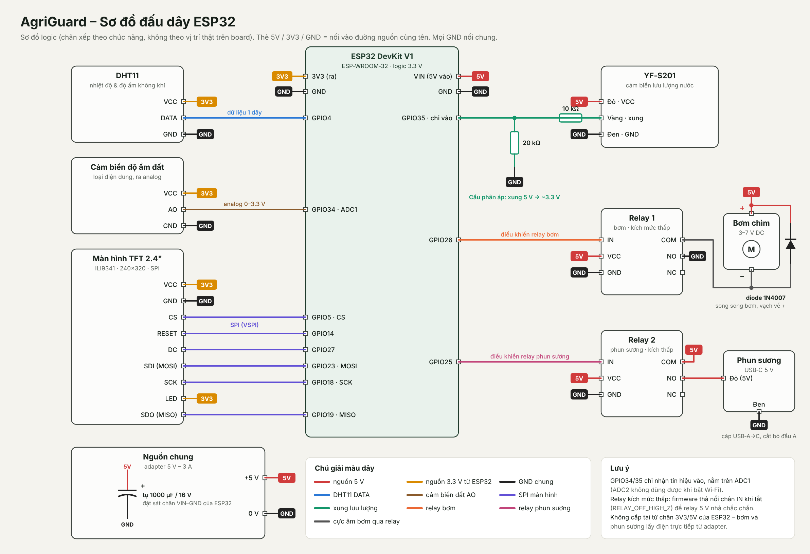

# AgriGuard – Sơ đồ đấu dây phần cứng



Bản vector (phóng to không vỡ, chèn vào slide): [wiring-diagram.svg](wiring-diagram.svg)

Toàn bộ hệ thống chạy **một nguồn 5V 3A** (bơm 3–7V và máy phun sương USB‑C đều dùng 5V).
ESP32 chỉ đóng/ngắt relay, **không cấp điện trực tiếp cho tải**. Mọi GND nối chung.

## 1. Sơ đồ tổng

```
                 Adapter 5V 3A
           (+5V) ─────┬──────────┬──────────┬──────────────┬──────────────┐
                      │          │          │              │              │
                  ESP32 VIN   Relay1 VCC  Relay2 VCC   YF-S201 (đỏ)   Cảm biến đất VCC*
                      │          │          │              │              │
           (GND) ─────┴──────────┴──────────┴──────────────┴──────────────┴── GND chung
                      │
                 Tụ 1000µF/16V giữa 5V và GND, đặt sát ESP32 (chống reset khi bơm khởi động)

  * Cảm biến đất loại điện dung: cấp 3.3V từ chân 3V3 của ESP32 để tín hiệu không vượt 3.3V.
```

## 2. Bảng chân

| Linh kiện | Chân linh kiện | Nối tới |
|---|---|---|
| **DHT11** | VCC / DATA / GND | 3V3 / **GPIO4** / GND |
| **Cảm biến ẩm đất** | VCC / AO / GND | 3V3 / **GPIO34** / GND |
| **YF‑S401** (trước đây YF‑S201) | Đỏ / Đen / Vàng | 5V / GND / **cầu phân áp → GPIO35** |
| **Relay 1 (bơm)** | VCC / GND / IN | 5V / GND / **GPIO26** |
| **Relay 2 (phun sương)** | VCC / GND / IN | 5V / GND / **GPIO25** |
| **TFT ILI9341** | SCK / MOSI / MISO / CS / DC / RST | 18 / 23 / 19 / 5 / 27 / 14 (sửa CS, DC trong `config.h` nếu bạn đấu khác) |

GPIO34 và GPIO35 nằm trên ADC1 và chỉ nhận đầu vào – đúng nhu cầu. Không dùng GPIO 0, 12, 15 cho relay.

## 3. Cảm biến lưu lượng YF‑S401 – cầu phân áp

```
Dây vàng ──[ 10kΩ ]──┬── GPIO35
                     │
                  [ 20kΩ ]
                     │
                    GND
```
Xung của YF‑S401 cao khoảng 4,7V khi cấp 5V → qua cầu còn ≈ 3,1V, an toàn cho ESP32. Không có 20kΩ thì dùng 2 điện trở 10kΩ nối tiếp. GPIO35 không có điện trở kéo bên trong: giữ nguyên cầu phân áp (20kΩ xuống GND cũng giữ chân không thả nổi khi rút cảm biến).

Lắp cảm biến **sau đầu ra của bơm**, đúng chiều mũi tên trên thân. YF‑S401 có đầu ống 7 mm cho **ống 6 mm** (không cần đầu chuyển ren như YF‑S201); siết kẹp để không hở khí, vì khí lọt vào làm mất xung.

**Thông số YF‑S401:** 0,3–6 L/phút, F = 98·Q Hz → **5880 xung/lít** (sai số ±10%), 5–24V. Firmware 0.5.5 đã đặt `FLOW_PULSES_PER_LITER 5880` và `FLOW_MIN_PULSE_US 800` (tối đa 588 Hz). YF‑S401 hợp với bơm mini 1–2 L/phút hơn YF‑S201 (YF‑S201 cần ≥ 1 L/phút mới đếm tốt).

**Hiệu chuẩn:** cho bơm chạy vào chai 1 lít, đếm tổng xung (`flow_liters_total` lúc `FLOW_PULSES_PER_LITER = 1`), ghi số xung vào `FLOW_PULSES_PER_LITER`.

**Sau khi thay cảm biến:** chạy `docker compose exec backend python -m app.reset_learning <device_id> --apply` rồi `docker compose restart backend` để hệ thống học lại %/L và lưu lượng bình thường bằng cảm biến mới.

## 4. Bơm chìm mini (3–7V) – Relay 1

```
+5V ───────────────────────────── Bơm (+, dây đỏ)
Bơm (−, dây đen) ── COM ┐
                        Relay 1   (dùng tiếp điểm NO: bình thường hở, kích thì đóng)
GND ──────────────────── NO ┘

Diode 1N4007 (hoặc 1N5819) song song với bơm: vạch trắng về phía +5V.
```
Diode hấp thụ xung điện áp ngược khi động cơ tắt, bảo vệ tiếp điểm relay và giảm nhiễu làm ESP32 treo.

## 5. Máy phun sương USB‑C – Relay 2

Máy tự phun khi có điện, nên chỉ cần đóng/ngắt dây 5V.

- Dùng **một sợi cáp USB‑A → USB‑C** (không dùng cáp C → C), cắt bỏ đầu USB‑A.
- Bên trong: dây **đỏ = 5V**, dây **đen = GND**. Các dây khác (trắng/xanh) để riêng, quấn băng keo.
- Cáp A → C có sẵn điện trở báo nguồn trong đầu C, nên máy phun nhận điện bình thường. Cáp C → C không có, máy sẽ không chạy.

```
+5V ── COM ┐
           Relay 2 ── NO ── dây đỏ cáp USB‑C ──> máy phun sương
GND ──────────────────────── dây đen cáp USB‑C
```

⚠️ Đĩa siêu âm chạy khô nhanh hỏng. Firmware có giới hạn `MIST_MAX_SECONDS`; server phát hiện "bật mà độ ẩm không tăng" và tắt máy.

## 6. Về module relay kích 5V

Mỗi relay được cấu hình **riêng** trong `config.h`:

| Relay | GPIO | Mức kích | Thả nổi khi tắt |
|---|---|---|---|
| Bơm | 26 | `PUMP_RELAY_ACTIVE_LOW` | `PUMP_RELAY_OFF_HIGH_Z` |
| Phun sương | 25 | `MIST_RELAY_ACTIVE_LOW` | `MIST_RELAY_OFF_HIGH_Z` |

Mặc định: **jumper H**, `*_ACTIVE_LOW false`, `*_OFF_HIGH_Z false` (ESP32 ra 3.3V kéo mức cao đủ chắc chắn).
Nếu module chỉ có kiểu kích mức thấp (jumper L): đặt `*_ACTIVE_LOW true` và `*_OFF_HIGH_Z true`.

**Kiểm tra nhanh trước khi đấu tải:** nạp firmware, bật/tắt trên web, nghe tiếng "tạch" và nhìn LED trên module.
- Relay làm ngược (web tắt mà relay đóng) → đổi true/false của `*_ACTIVE_LOW` cho relay đó.
- Tắt mà không nhả ở jumper L dù đã thả nổi → chuyển sang jumper H, hoặc dùng module MOSFET.

## 7. Danh sách cần có

| Món | SL | Ghi chú |
|---|---|---|
| Module relay 1 kênh 5V | **+1** (đang có 1) | Hoặc đổi sang loại 2 kênh |
| Adapter 5V 3A + jack DC cái | 1 | |
| Cáp USB‑A → USB‑C | 1 | Để cắt làm dây cho máy phun |
| Diode 1N4007 / 1N5819 | 2 | 1 cho bơm, 1 dự phòng |
| Điện trở 10kΩ, 20kΩ | 1 mỗi loại | Cầu phân áp YF‑S401 |
| Tụ hóa 1000µF 16V | 1 | Chống sụt áp |
| Ống mềm 6 mm, kẹp ống | 2 bộ | Cho YF‑S401 |
| Breadboard / dây cắm / domino | | |

## 8. Thông điệp MQTT

Base topic: `agri/farm-a/esp32-01/`

| Topic | Chiều | Nội dung |
|---|---|---|
| `telemetry` | ESP32 → server, mỗi 5s | nhiệt độ, độ ẩm, đất, bơm, phun sương, lưu lượng, RSSI, `seq` |
| `status` | ESP32 → server, mỗi 15s, retained | online, fw, uptime, heap, reset_reason, số lần kết nối lại. LWT gửi `online:false` khi mất kết nối |
| `cmd` | server → ESP32 | `{"command_id":"c1","actuator":"pump","action":"on","duration_s":120}` – action: `on`, `off`, `clear_lockout` |
| `ack` | ESP32 → server | `command_id`, `ok`, `state`, `lockout`, `reason` |
| `event` | ESP32 → server | `safety_lockout` (dry_run), `max_runtime_cutoff`, `auto_off`, `flow_without_pump`, `bad_command` |

## 9. An toàn cục bộ (chạy kể cả khi mất server)

- Bơm chạy quá `PUMP_MAX_SECONDS`, phun sương quá `MIST_MAX_SECONDS` → tự tắt.
- Bơm bật mà lưu lượng < 0.3 L/phút quá 60s (sau 8s mồi nước) → tắt và **khoá bơm**, chờ lệnh `clear_lockout` từ web. Đây chính là bước "Resolve" trong kịch bản D‑I‑R.
- Bơm tắt mà vẫn có dòng chảy > 10s → báo `flow_without_pump` (relay kẹt / rò).
- Mất MQTT quá 120s → tắt mọi thiết bị.
- `reset_reason = brownout` trong status → nguồn yếu khi bơm khởi động; Datadog bắt được qua `uptime` reset.
